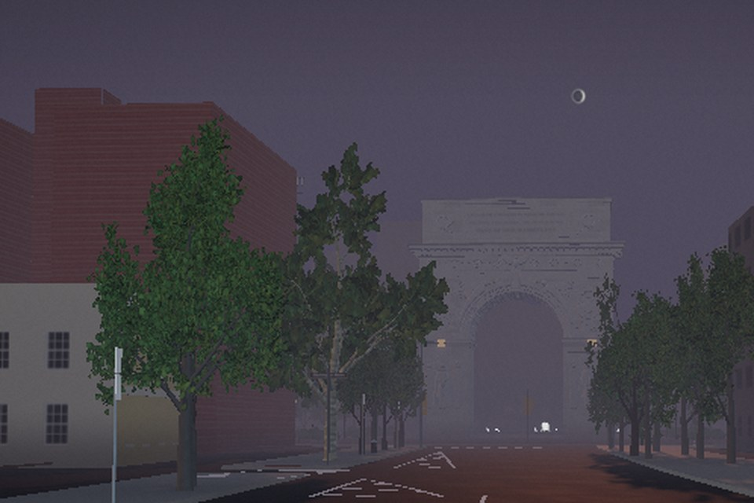
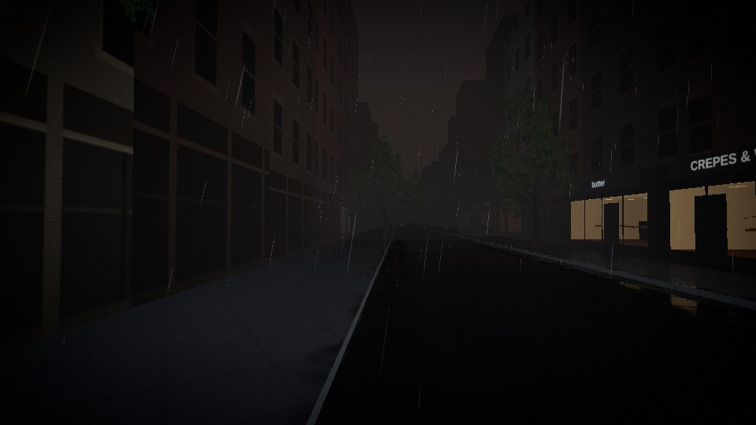
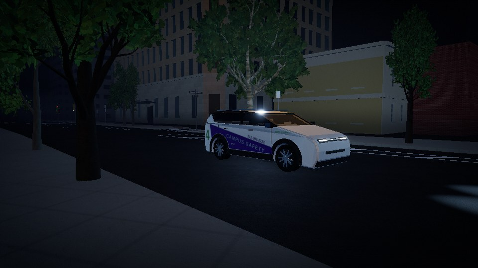
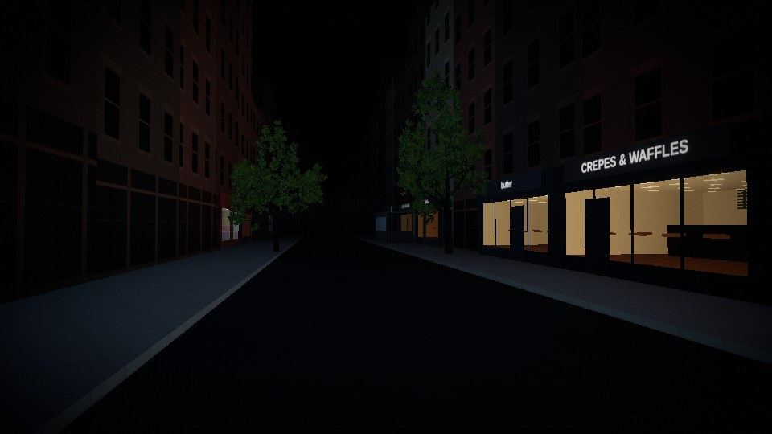

<p align="center"></p>

<h1 align="center">Commencement</h1>


<p align="center"><a href="https://sormazi.github.io/Commencement/"></a></p>

<p align="center"></p>

Commencement is Washington Square Park and the streets, buildings, businesses and people around it, rebuilt one to one.

## The haunted one

You start on an ordinary evening in 2026. The square is busy, the shops are lit, the fountain's going. You're driving Campus Safety's unit 4 on a normal patrol.

Then, partway through, the world tears, and it's 2126. Nobody's left. Trees have come up through the paths and ivy has taken most of the buildings. The car still starts, which makes you the last patrol on campus. I'll leave the rest for you to find.

<table>
<tr>
<td width="50%"></td>
<td width="50%"></td>
</tr>
<tr>
<td align="center">Bleecker Street, raining</td>
<td align="center">Unit 4</td>
</tr>
</table>

## Campus (coming, not playable yet)

The other way in is Campus, a shared version of the same 2026 neighborhood. The idea is that you can walk around it with other people: find your friends, run into people you don't know yet, study together in Bobst, meet up with your club, and leave notes and recommendations at real places for whoever comes by next. It should show up for the same moments the real campus does, like move-in week, finals, the tree going up at the Arch, the Halloween parade, and Commencement itself. There will be AI NPCs making the place lively and introducing new things to do. I'm building it now. It isn't available yet, and I'll update this when it is.

## Why I'm making this

The campus is spread through the city, and it's easy to go a whole semester feeling like you're on your own in it, even surrounded by people. I wanted a version of this place where people can actually find each other.

## How close is it to the real thing?

As close as I can get it. The streets are the real streets at their real widths, every building sits on its real footprint at its real height, and the street trees are the real ones, species and all, from the city's own tree records. The shops are the real shops under their real names, filled in block by block. The light follows the actual time in New York, so if you play at two in the morning it's two in the morning in the square, and the weather is live: if it's raining in Manhattan, it's raining here.

<p align="center"></p>

## Controls

| | |
| :--- | :--- |
| Drive and brake, or reverse | W / S or the arrow keys |
| Steer | A / D or the arrow keys |
| Parking brake | Space |
| Put the car back on the street | R |
| Pause | Esc |


## Run it yourself

You need Python 3 and a browser that does WebGL 2, which is any recent one.

```bash
git clone https://github.com/sormazi/Commencement.git
cd Commencement
python3 tools/serve.py
```

Then open http://localhost:4173. If something else is already using that port, run `python3 tools/serve.py 4180` and open http://localhost:4180 instead.

## What's coming

- Getting out of the car and walking around
- Campus, the shared version of the neighborhood
- Going inside buildings, starting with Bobst
- A story

---

Map data © OpenStreetMap contributors (ODbL) and NYC Open Data. Weather from [Open-Meteo](https://open-meteo.com/) (CC BY 4.0), with the [National Weather Service](https://www.weather.gov/) as a backup. Trees are grown with [EZ-Tree](https://github.com/dgreenheck/ez-tree) by Daniel Greenheck (MIT). Instrument sounds from FluidR3_GM (MIT). Reference photos are from Wikimedia Commons. Everything is credited in full in [the credits](dist/credits.html).
